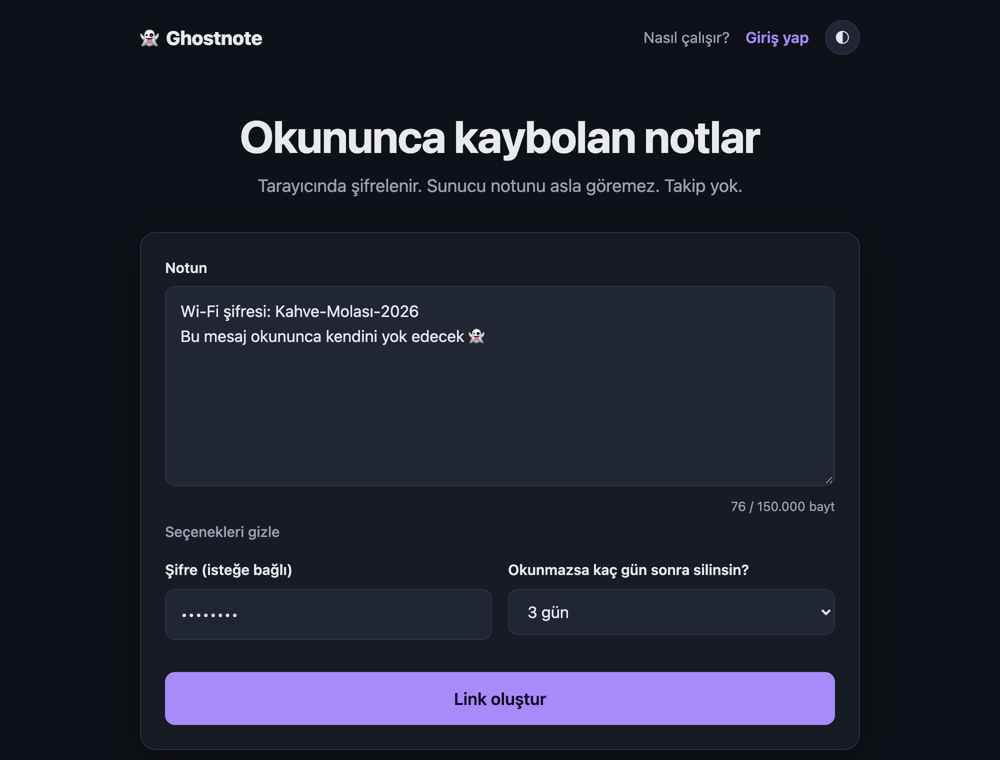
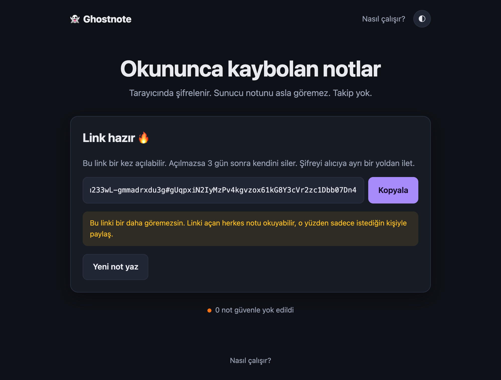
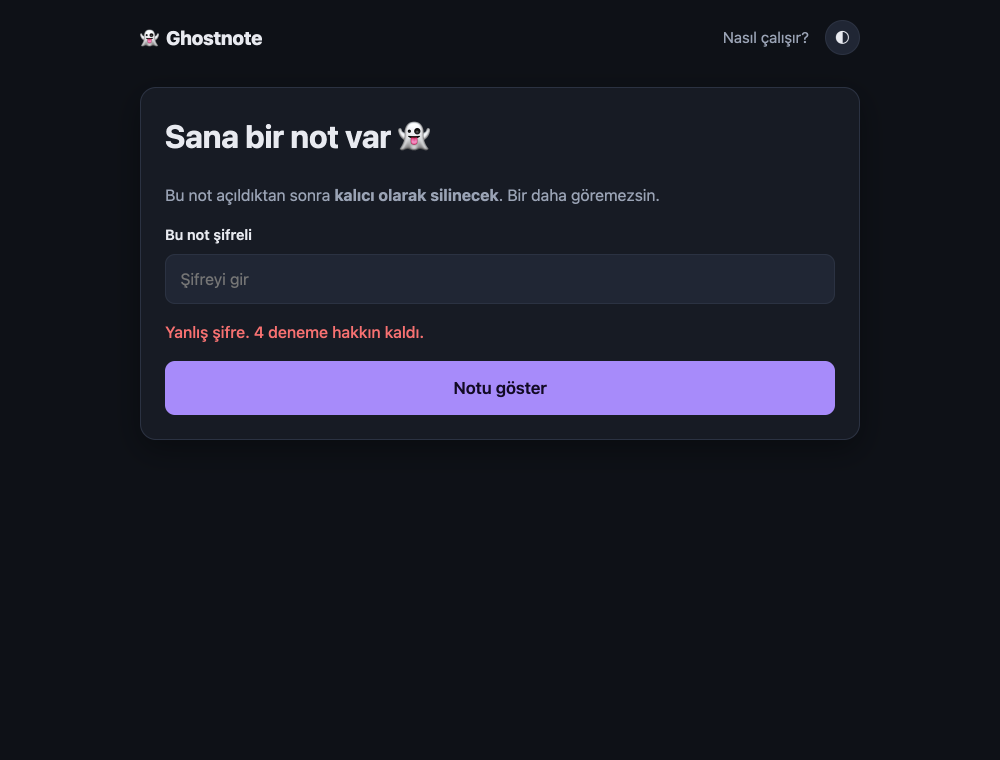
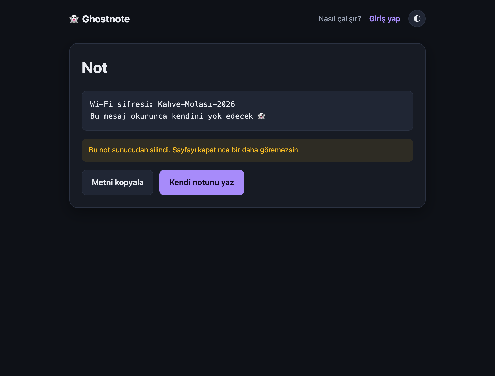
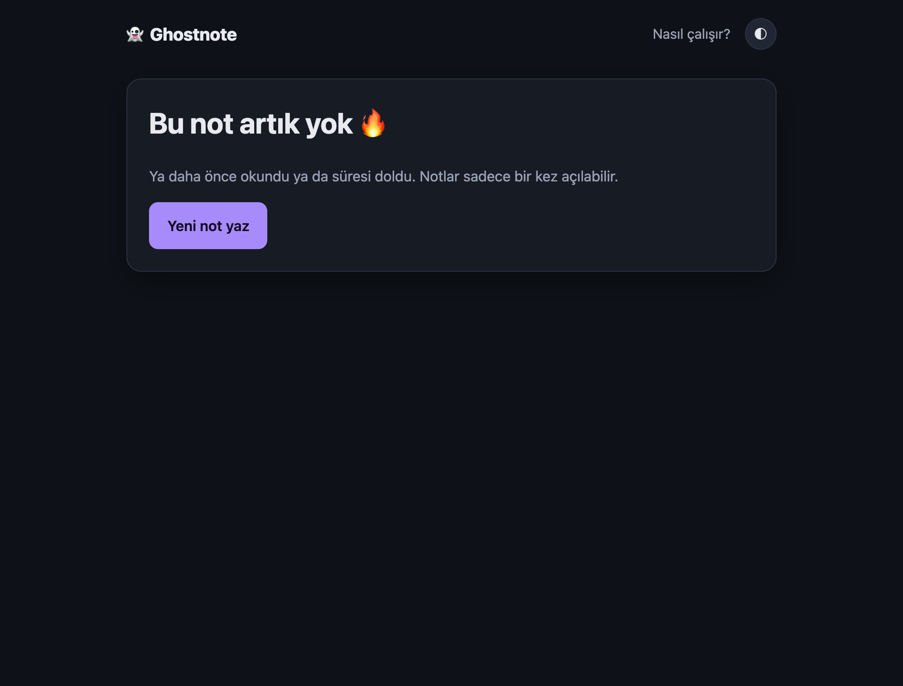
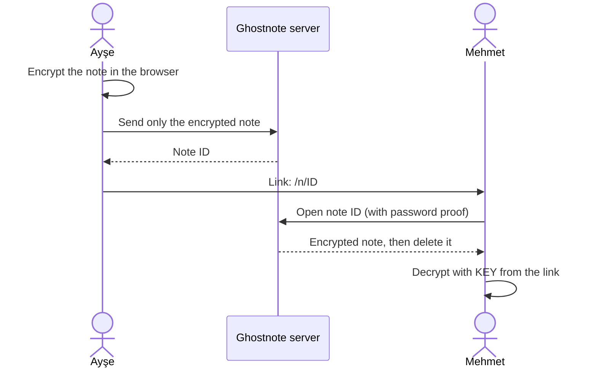
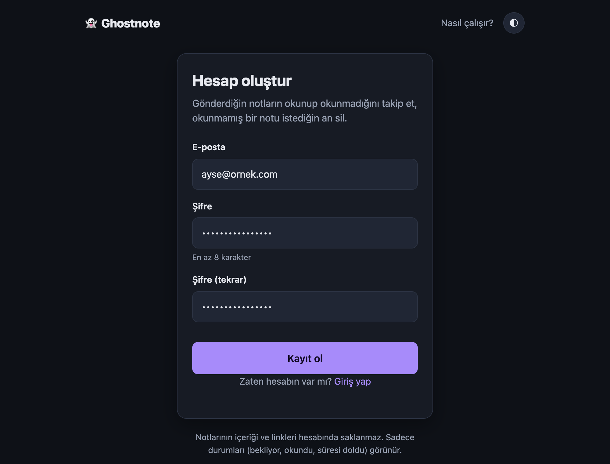
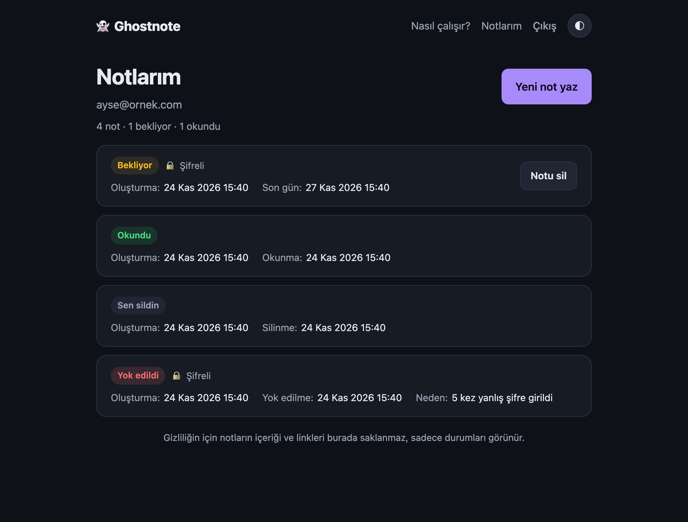
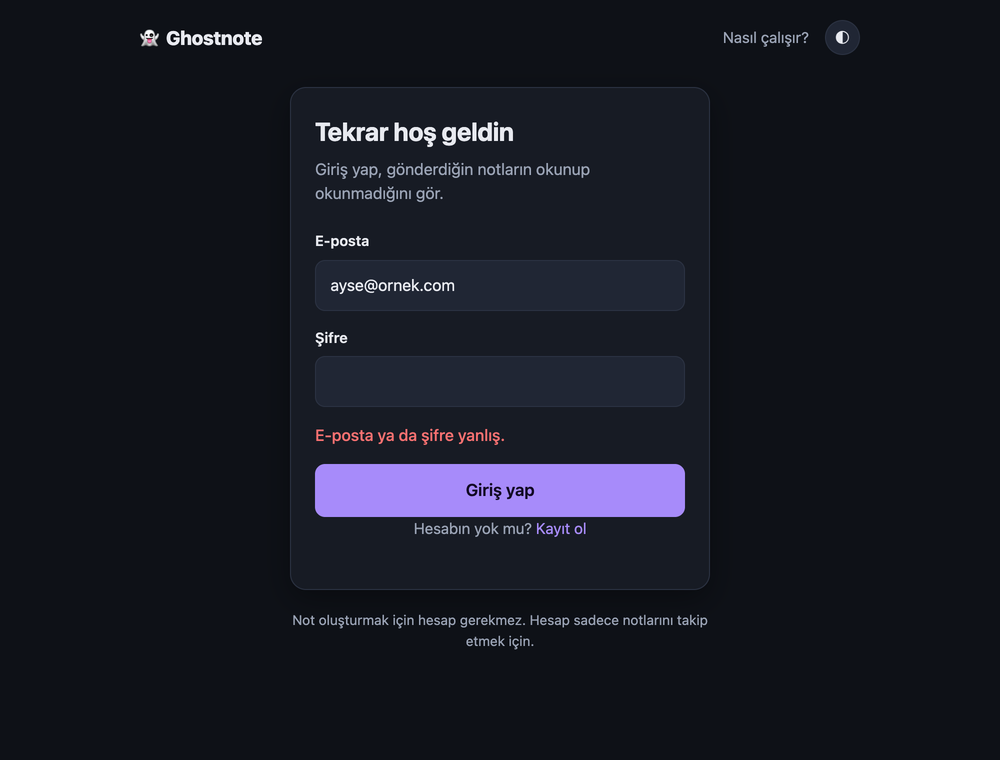
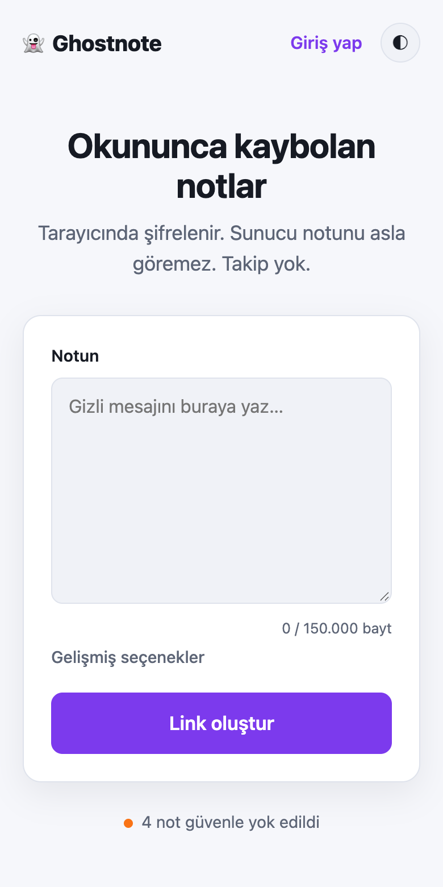

# Ghostnote 👻

[](https://github.com/azadaygun65-byte/ghostnote/actions/workflows/test.yml)
[](LICENSE)


Self-destructing, end-to-end encrypted notes. Write a note, get a link, and the note is deleted the moment it is read.

> Inspired by the idea behind burnernote.com. Written from scratch.



## Example: sharing a Wi-Fi password

Ayşe wants to send Mehmet the office Wi-Fi password without it sitting in their chat history forever.

**1. Ayşe writes the note.** She opens Ghostnote, types the password, and under *Gelişmiş seçenekler* (advanced options) adds a password (`gizli123`) and picks 3 days.

**2. She gets a one-time link.** She sends the link to Mehmet on WhatsApp, and tells him the password by phone.



**3. Mehmet opens the link.** Ghostnote asks for the password first. A wrong password does not destroy the note; after 5 wrong tries it is destroyed.



**4. He reads the note.** With the right password, the note is decrypted in his browser and deleted from the server at the same moment.



**5. The link is now dead.** If anyone opens the link again, even Mehmet, the note is gone. If Mehmet had never opened it, it would have deleted itself after 3 days.





## Example: tracking notes with an account

Accounts are optional. Ayşe creates one because she wants to know when her notes are read.

**6. Ayşe signs up** with her email and a password of at least 8 characters.



**7. She checks Notlarım (my notes).** Every note she creates while signed in shows up here with its status: waiting, read (and when), deleted by her, or destroyed after 5 wrong passwords. She can still delete a note nobody has opened. The page never shows a note's content or link, only its status.



**8. Wrong passwords are rejected.** The error is the same whether the email exists or not, so nobody can find out who has an account, and login attempts are rate limited.



It also works on phones, in light and dark themes:



## Run it

Requires Node.js 22.13 or newer. No dependencies to install.

```bash
npm start        # http://localhost:3000
npm run dev      # same, restarts on file changes
npm test         # run the test suite
```

Environment variables:

| Variable | Default | Purpose |
|---|---|---|
| `PORT` | `3000` | HTTP port |
| `DB_FILE` | `data/ghostnote.db` | SQLite database file |
| `COOKIE_SECURE` | unset | Set to `1` in production (HTTPS) to mark the session cookie `Secure` |

## How it works

1. The browser generates a random 256-bit AES-GCM key (Web Crypto API).
2. The note is encrypted in the browser. A random 96-bit IV is prepended to the ciphertext.
3. Only the ciphertext is sent to the server.
4. The key goes in the URL fragment (`#...`), which browsers never send to the server.
5. Opening the link shows a confirmation screen first, so link previews and bots cannot burn the note.
6. On "Show note", the server returns the ciphertext and deletes it in the same request. The browser decrypts it locally and removes the key from the address bar.

The server never sees the key, so it can never read a note.

### Password protection

If a password is set, PBKDF2-SHA256 (310,000 iterations) turns it into two independent 256-bit values:

- **encKey** adds a second layer of AES-GCM encryption. It never leaves the browser.
- **auth** proves the password to the server, which stores only an scrypt hash of it.

A wrong password does not burn the note. After 5 wrong attempts, the note is destroyed.

### Accounts (optional)

Anyone can create notes without an account. Signing up adds a **Notlarım** (my notes) page that shows, for each note you created while signed in, whether it is still waiting, was read, expired, was destroyed by wrong passwords, or was deleted by you. You can delete a note that has not been read yet.

The account never stores a note's content, key or link: only its status and dates.

- **Passwords** are hashed with scrypt (random salt per user). A failed login takes the same time and returns the same error whether or not the email exists.
- **Sessions** use a random 256-bit token in an `HttpOnly`, `SameSite=Lax` cookie that lasts 30 days. The database stores only a SHA-256 hash of the token, and logging out deletes it on the server.
- **Cross-site requests** that change state are rejected by checking the `Origin` header.
- **Login and register** are rate limited to 10 attempts per 15 minutes per IP.

## Features

- [x] Client-side AES-256-GCM encryption, key in the URL fragment
- [x] Burn after reading (1 view), hard delete
- [x] Expiry in days (1 to 30, default 7), with an hourly cleanup job
- [x] Optional password, 5 attempts max
- [x] Confirmation screen before opening (safe from link previews)
- [x] Dark / light theme
- [x] "Notes destroyed" counter
- [x] Strict security headers (CSP, no referrer, no framing), rate limiting
- [x] Optional accounts: register, login, logout
- [x] "Notlarım" page: see if your notes were read, delete unread ones

## Later

- [ ] Multiple allowed views
- [ ] Email notification when a note is read
- [ ] Email verification and password reset
- [ ] Encrypted file attachments
- [ ] Public inbox

## Project layout

```
src/server.js       HTTP server, API, static files
src/store.js        SQLite storage (node:sqlite): notes, users, sessions
src/auth.js         Password hashing, session tokens, cookies
public/             Pages, styles and browser code
public/js/crypto.js All encryption (shared by browser and tests)
test/               Tests (node:test), run on every push by GitHub Actions
```

## API

| Method | Path | Purpose |
|---|---|---|
| `POST` | `/api/notes` | Create a note: `{ ciphertext, expiresInDays, password?: { salt, auth } }` → `{ id, tracked }` |
| `GET` | `/api/notes/:id` | Check a note exists, without burning it → `{ hasPassword, salt, expiresAt }` |
| `POST` | `/api/notes/:id/open` | Get the ciphertext and burn the note: `{ auth? }` → `{ ciphertext }` |
| `GET` | `/api/stats` | `{ destroyed }` |
| `POST` | `/api/auth/register` | `{ email, password }` → `{ user }` and a session cookie |
| `POST` | `/api/auth/login` | `{ email, password }` → `{ user }` and a session cookie |
| `POST` | `/api/auth/logout` | Ends the session |
| `GET` | `/api/auth/me` | `{ user }`, or `{ user: null }` when signed out |
| `GET` | `/api/my/notes` | Your notes' statuses (signed in) |
| `DELETE` | `/api/my/notes/:id` | Delete one of your unread notes (signed in) |

## Security notes

- Client-side encryption cannot protect against a compromised device, malicious browser extensions, or someone copying the text after it is decrypted.
- Run behind HTTPS in production. The rate limiter uses the socket IP, so behind a reverse proxy it needs to read the forwarded client IP instead.

## License

[MIT](LICENSE) © 2026 Azad Aygün
